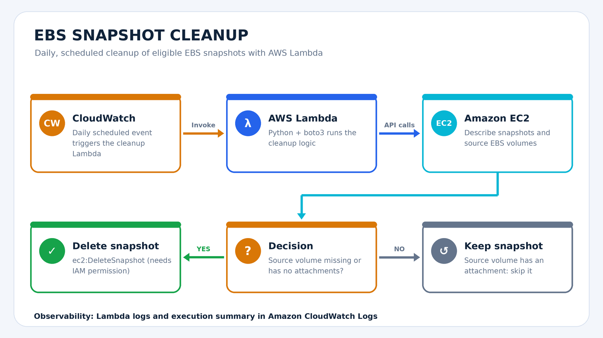
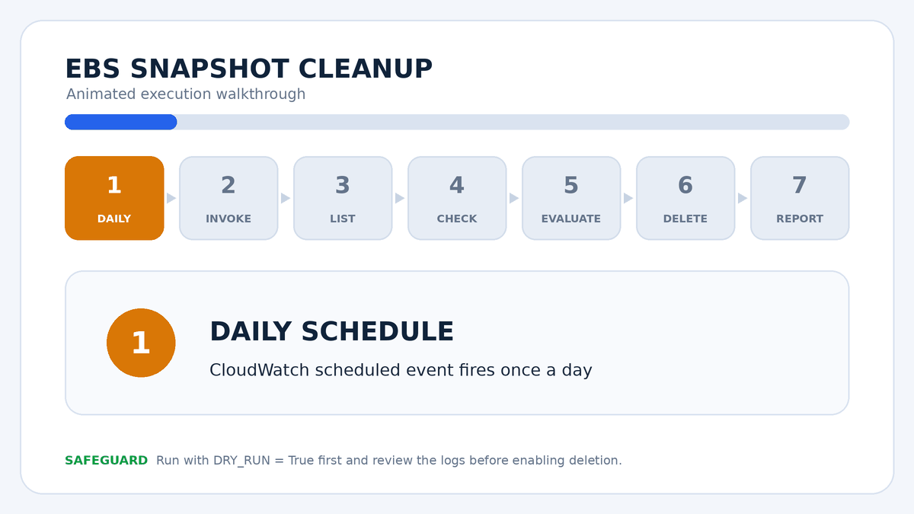

# AWS EBS Snapshot Cleanup (Python Lambda + CloudWatch Daily Trigger)

A serverless automation project that checks EBS snapshots owned by your AWS account and removes snapshots whose source volume is missing or unattached. A daily Amazon CloudWatch scheduled event triggers the Lambda function, and Amazon CloudWatch Logs provides execution visibility.

> **Important:** Snapshot deletion is permanent. Validate every candidate against your backup-retention policy, recovery requirements, registered AMIs, and AWS Backup before enabling unattended deletion.

## At a glance

- **Runtime:** Python on AWS Lambda
- **AWS SDK:** boto3
- **APIs used:** Amazon EC2 (`DescribeSnapshots`, `DescribeVolumes`, `DeleteSnapshot`)
- **Trigger:** Amazon CloudWatch scheduled event (daily)
- **Logs:** Amazon CloudWatch Logs
- **Permissions:** IAM execution role

## Architecture



### Components

| Component | Responsibility |
|---|---|
| Amazon CloudWatch (scheduled event) | Triggers the Lambda function once a day. |
| AWS Lambda | Runs the Python cleanup logic without managing servers. |
| boto3 / EC2 API | Lists account-owned snapshots and checks each snapshot's source volume. |
| IAM execution role | Grants the Lambda only the AWS API permissions it needs. |
| CloudWatch Logs | Stores the function's progress, errors, and final execution summary. |

## Animated execution flow



### What the function does

1. The CloudWatch daily scheduled event triggers the Lambda.
2. Lambda creates a boto3 EC2 client.
3. A paginator retrieves snapshots owned by the account (`OwnerIds=['self']`).
4. For each snapshot, the function reads its `VolumeId`. A snapshot with no `VolumeId` is skipped.
5. It calls `DescribeVolumes` to check whether the original source volume still exists.
6. It evaluates the source volume:
   - **Source volume not found (`InvalidVolume.NotFound`):** the snapshot is a deletion candidate.
   - **Source volume exists but has no attachments:** the snapshot is a deletion candidate.
   - **Source volume has one or more attachments:** the snapshot is kept.
   - **Any other error while checking the volume:** the snapshot is skipped and the error is logged.
7. If `DRY_RUN = True`, the function logs what it *would* delete.
8. If `DRY_RUN = False`, it calls `DeleteSnapshot`. A failed deletion for a missing-volume snapshot is logged and the run continues.
9. The function prints a summary of candidate, deleted, and skipped counts and returns it as the response.

### Decision logic

```text
                    Snapshot found
                          |
                     Has VolumeId?
                    /            \
                  No              Yes
                  |                |
                Skip       Describe source volume
                                   |
                  +----------------+----------------+
                  |                |                |
           Volume not found   Volume exists    Other error
                  |                |                |
              Candidate     Check attachments   Skip + log
                                   |
                        +----------+----------+
                        |                     |
                  No attachments        Has attachment(s)
                        |                     |
                    Candidate               Keep
                        |
                 DRY_RUN enabled?
                   /          \
                 Yes           No
                 |              |
             Log only     DeleteSnapshot
```

## Repository structure

```text
aws-ebs-snapshot-cleanup/
├── lambda_function.py
├── README.md
├── architecture.png
└── execution-flow.gif
```

## Deployment

1. Create a Lambda function using a current Python runtime.
2. Paste the contents of `lambda_function.py` as the function code and deploy it.
3. Attach the permissions in the [IAM permissions](#iam-permissions) section to the function's execution role.
4. Increase the function timeout if your account has many snapshots (the default of 3 seconds is usually too short).
5. Create the daily CloudWatch trigger described in [Create the daily trigger](#create-the-daily-trigger-with-cloudwatch).

## Configuration

The cleanup behaviour is controlled by one constant in `lambda_function.py`:

```python
DRY_RUN = False
```

- `True`: report deletion candidates without deleting anything.
- `False`: call `ec2.delete_snapshot()` for each candidate.

> **Warning:** the code in this repository is committed with `DRY_RUN = False`, so deletion is **enabled** as soon as it is deployed. For a first run in any account, change it to `True`.

**Recommended rollout:** deploy with `DRY_RUN = True`, inspect the CloudWatch logs and verify the candidate list, then change to `False` only after confirming the cleanup criteria are appropriate for your environment.

## IAM permissions

Attach permissions to the **Lambda execution role**, not to your personal IAM user. The role name is visible in **Lambda → Configuration → Permissions**.

The following is an example policy for the behaviour described above. Replace `<REGION>` and `<ACCOUNT_ID>` with your own values.

```json
{
  "Version": "2012-10-17",
  "Statement": [
    {
      "Sid": "ReadEc2SnapshotAndVolumeState",
      "Effect": "Allow",
      "Action": [
        "ec2:DescribeSnapshots",
        "ec2:DescribeVolumes"
      ],
      "Resource": "*"
    },
    {
      "Sid": "DeleteOwnedSnapshotsInThisRegion",
      "Effect": "Allow",
      "Action": "ec2:DeleteSnapshot",
      "Resource": "arn:aws:ec2:<REGION>:<ACCOUNT_ID>:snapshot/*"
    },
    {
      "Sid": "WriteLambdaLogs",
      "Effect": "Allow",
      "Action": [
        "logs:CreateLogGroup",
        "logs:CreateLogStream",
        "logs:PutLogEvents"
      ],
      "Resource": "*"
    }
  ]
}
```

Keep the region and account scope aligned with the Lambda's deployment. If the role already has the standard `AWSLambdaBasicExecutionRole`, the CloudWatch Logs permissions may already be covered.

An explicit deny in an AWS Organizations service control policy, permissions boundary, or another applicable policy can still block deletion even when this identity policy allows it.

## Create the daily trigger with CloudWatch

The Lambda is triggered by a **CloudWatch scheduled event** that runs once a day.

1. Open the **CloudWatch** console in the same AWS Region as the Lambda function and create a scheduled rule (under **Events → Rules**).
2. Choose a **schedule** as the event source and enter a daily expression, for example `cron(0 2 * * ? *)` for every day at 02:00 **UTC**. A fixed rate of `rate(1 day)` also works.
3. Set the target to your EBS cleanup Lambda function.
4. Allow the rule to invoke the Lambda when prompted.
5. Create the rule and confirm it is **enabled**.

**Note:** AWS has moved scheduled-event rules into Amazon EventBridge, which is the service that now hosts them (formerly CloudWatch Events). The console may therefore show EventBridge in the page title. This project uses the CloudWatch scheduled-event trigger, not a separate EventBridge Scheduler setup.

**Time-zone note:** rule cron expressions are evaluated in UTC. India Standard Time is UTC+05:30, so 02:00 UTC is 07:30 IST. Choose a time that fits your backup and maintenance windows.

## Testing and verification

### 1. Test in dry-run mode

Set `DRY_RUN = True`, deploy the code, and invoke a Lambda test event. Inspect the execution logs.

Example dry-run log:

```text
Checking snapshot: snap-xxxxxxxx, Volume: vol-xxxxxxxx
[DRY RUN] Would delete snapshot snap-xxxxxxxx: Source volume no longer exists.
========== CLEANUP SUMMARY ==========
Deletion candidates: 1
Deleted snapshots: 0
Skipped snapshots: 0
Dry run enabled: True
```

A snapshot of an unattached (but existing) volume logs `[DRY RUN] Would delete snapshot snap-xxxxxxxx from unattached volume vol-xxxxxxxx`. A snapshot of an attached volume logs `Keeping snapshot snap-xxxxxxxx: Volume vol-xxxxxxxx is attached to an EC2 instance.`

### 2. Enable deletion only after review

After validating the candidate snapshots and retention requirements, set `DRY_RUN = False`, deploy, and run a controlled test.

A successful deletion should produce a log similar to:

```text
Deleted snapshot snap-xxxxxxxx
========== CLEANUP SUMMARY ==========
Deletion candidates: 1
Deleted snapshots: 1
Skipped snapshots: 0
Dry run enabled: False
```

### 3. Confirm in the EC2 console

Open **EC2 → Elastic Block Store → Snapshots** in the same Region. Search for the snapshot ID and confirm its state. Snapshot deletion may take time to be reflected in the console.

## Safety and operational considerations

- **Unattached does not always mean unused.** A volume may be deliberately detached for maintenance, migration, or recovery. This project's current rule treats a snapshot of any unattached source volume as a candidate.
- **Stopped instances:** an EBS volume attached to a stopped instance still has an attachment and is therefore kept by this logic.
- **AMI dependencies:** check whether a snapshot backs a registered AMI. Do not delete snapshots required by images or deployment workflows. (AWS rejects deletion of a snapshot that is in use by an AMI, but do not rely on that as a safeguard.)
- **AWS Backup:** manage AWS Backup recovery points through AWS Backup lifecycle and retention controls rather than treating them as ordinary manually managed snapshots.
- **Retention policy:** consider tagging snapshots with retention dates or excluding protected snapshots before using this in production.
- **Region scope:** EBS snapshots are regional. Deploy and schedule the Lambda in each Region you intend to clean up.
- **Deletion is irreversible:** there is no undo for a deleted snapshot. Maintain independent backups for important data.

### Recommended production improvement

Before expanding the automation, consider adding an explicit opt-in tag requirement, such as:

```text
CleanupEligible = true
```

Then only delete snapshots that both meet the volume criteria and carry the approved tag. This reduces the risk of deleting backups that are intentionally retained.

## Troubleshooting

| Symptom | Likely cause | What to check |
|---|---|---|
| `UnauthorizedOperation` on `DeleteSnapshot` | Lambda role lacks deletion permission | Add `ec2:DeleteSnapshot` to the Lambda execution role, scoped to the intended account and Region. |
| `UnauthorizedOperation` on `DescribeVolumes` | Lambda role lacks read permission | Add `ec2:DescribeVolumes` with `Resource: "*"` as required by EC2 describe APIs. |
| `candidates: 0` | No snapshots meet the current criteria | Review source volume state and the function's filtering logic. |
| `deleted: 0`, `dry_run: true` | Dry-run mode is enabled | This is expected; no snapshots are deleted. |
| Lambda times out | Many snapshots to process | Increase the function timeout. |
| Lambda test succeeds but scheduled run does not happen | Rule disabled, wrong Region, or target permission issue | Check the rule state, target, invocation permission, and Lambda metrics. |
| Snapshot is still visible after deletion call | Deletion may still be processing, or the call failed | Check the Lambda logs and refresh the Snapshots page in the correct Region. |

## Monitoring

Use **CloudWatch → Log groups → `/aws/lambda/<your-function-name>`** to inspect:
- Snapshot IDs checked
- Candidate and skip decisions
- Deletion success or failure messages
- Final candidate, deleted, and skipped counts

For production use, consider CloudWatch alarms for Lambda errors and missed or failed scheduled invocations.

## Project status

- [x] Lambda identifies snapshots whose source volume is missing.
- [x] Lambda identifies snapshots whose source volume has no attachments.
- [x] Lambda keeps snapshots whose source volume has an attachment.
- [x] Dry-run mode is available for safe validation.
- [x] IAM deletion permission configured for the target account and Region.
- [x] Daily CloudWatch scheduled trigger configured.
- [ ] Production retention and snapshot-tag safeguards reviewed.

## Disclaimer

This project is an infrastructure-cleanup example, not a replacement for a formal backup lifecycle policy. Test in a non-production account first and review every deletion condition before enabling unattended execution.
